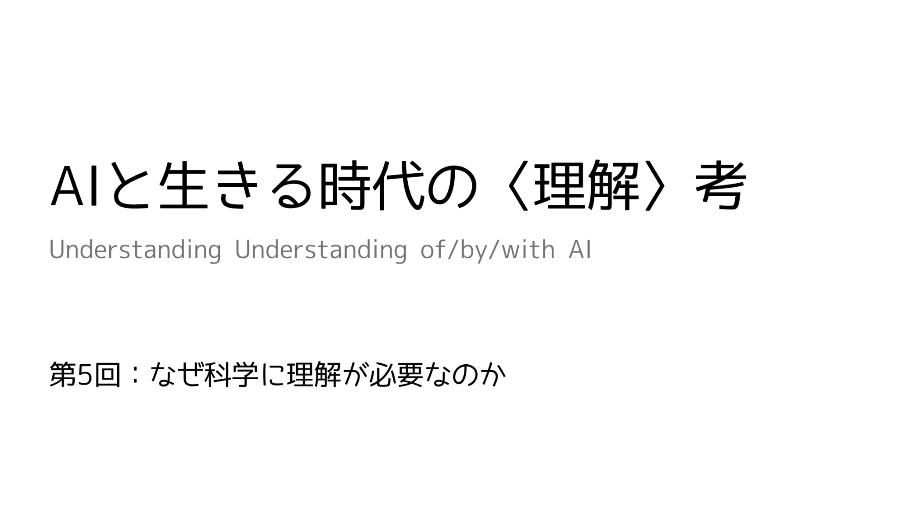
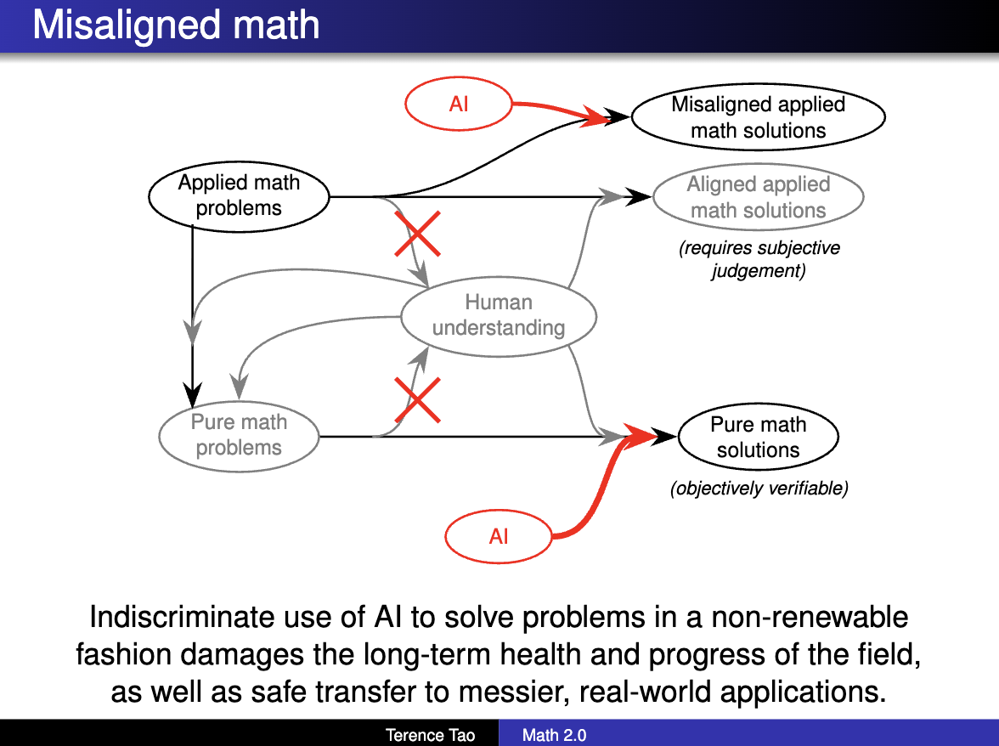
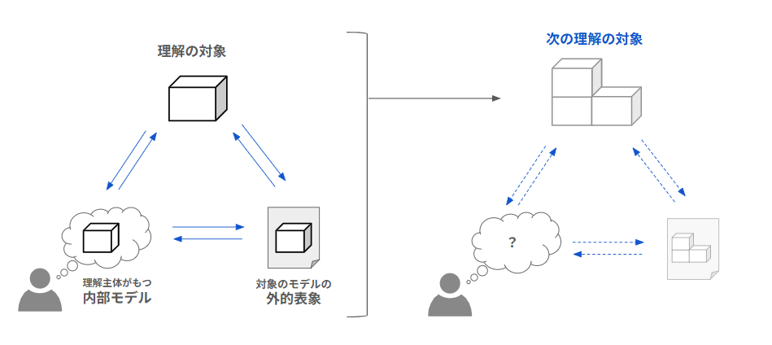
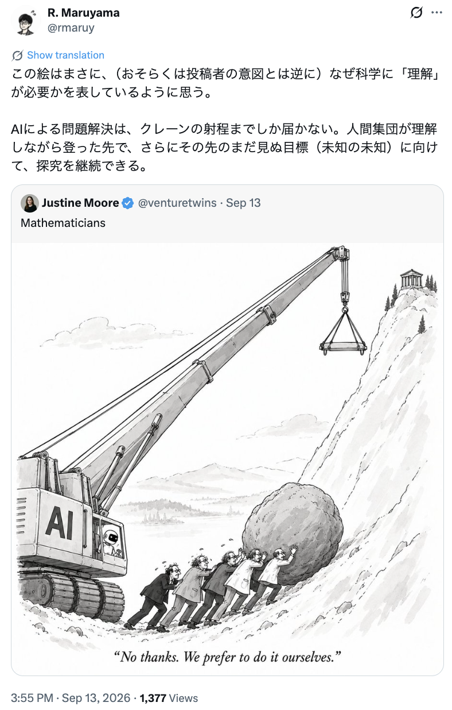
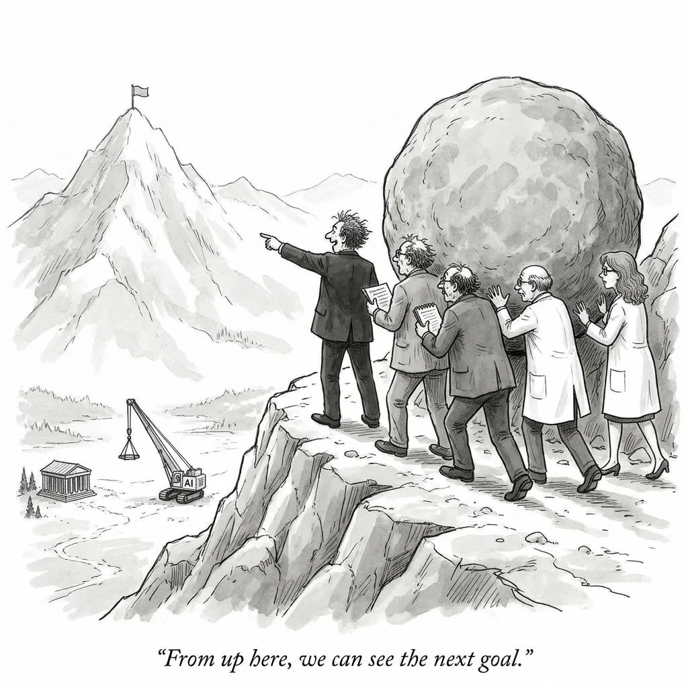

*第5回：なぜ科学に理解が必要なのか*

本連載「AIと生きる時代の〈理解〉考」は、生成AIの登場により人間だけが理解の主体ではなくなったように思える今、改めて理解とは何か、私たちは何をどう理解して生きていけばよいのかを考えるブログ連載です。本記事はその第5回です[^1]。

> **連載「AIと生きる時代の〈理解〉考」**
>
> - [第0回：連載を始めるにあたって](https://rmaruy3.github.io/blog/2026/02/01/post.html)
> - [第1回：LLMは理解しているのか？](https://rmaruy3.github.io/blog/2026/02/17/post.html)
> - [第2回：理解の価値とは何か](https://rmaruy3.github.io/blog/2026/05/04/post.html)
> - [第3回：理解の作業モデルをつくる](https://rmaruy3.github.io/blog/2026/08/23/post.html)
> - [第4回：理解考からみたAIスロップ問題](https://rmaruy3.github.io/blog/2026/09/29/post.html)
> - **第5回：なぜ科学に理解が必要なのか**（本記事）

【第5回目次】

- [AIが問う、科学における理解の価値](#aiが問う科学における理解の価値)
- [「数学2.0」](#数学20)
- [目的としての理解と、手段としての理解](#目的としての理解と手段としての理解)
- [未来の科学のための理解](#未来の科学のための理解)
- [なぜ「できる」のに「わかる」努力が必要なのか](#なぜできるのにわかる努力が必要なのか)
- [参考文献](#参考文献)

＊＊＊

#### **AIが問う、科学における理解の価値**

前回は「AIスロップ問題」を扱った。いま、一見まともだが人の手がかかっていないAI生成の文章やスライドが、スロップ（生ゴミ）と呼ばれるほどに忌み嫌われている。本連載では、理解を対象・内部モデル・外的表象の三つの結びつきとして捉えるが、AIスロップはその三つのうち内部モデルと外的表象がほどけた状態として理解できる。本来、文章やスライドなどの外的表象は、人間同士で内部モデルを共有するための接木として機能する。しかし、AI生成の外的表象は誰の内部モデルにも紐づかず、私たちの集団としての理解を阻害する（[第4回](https://rmaruy3.github.io/blog/2026/09/29/post.html)）。

そして、こうした問題がとりわけ顕在化している分野の一つが科学だ。しかし、AIが生み出す論文はスロップとも言い切れない。OpenAIが数学の未解決問題を一気に数百個も解き、物理学においても成果を主張している。AI企業各社が「研究を行うAI」を相次いで開発し、科学の担い手としてのAIというビジョンがますます現実的になってきた[^2]。人間が中身を理解するよりも早くAIが科学を行う時代がやってきたかのようだ。

AIが科学できる時代に、人間が理解しなくても科学は進むのだろうか。それとも、まだ人間の理解は重要であり続けるのだろうか。本稿では、科学における理解の価値について考える。

#### **「数学2.0」**

数学者テレンス・タオは、調和解析や数論などの分野で知られるフィールズ賞受賞者だが、AIの数学への影響について精力的に発信している一人だ。タオは先月"Math 2.0"と題した講演を行った[^3]。

その中で彼は、数学が**証明が希少な（proof scarcity）時代**から、**証明が有り余る（proof abundance）時代**に移行したという。かつて数学者の仕事の大きな部分は、ある問題に取り組み、その証明を作り出す作業に充てられており、そこで作られる証明に希少性があった。しかし、AIによって既存の問題に対する証明は大量に生み出されるようになった。この証明が有り余る時代には、むしろ数学者たちはAIの証明をチェックすることに追われ始めた。

人間の理解を経ずに、数学の問題が解かれ始めたことは、数学にとって危険な事態だとタオはいう。なぜなら、人間の理解を伴わないAI活用は数学にいくつかのミスアラインメント、つまり目的と手段のずれをもたらしうるからだ。しかし、だからといってAIを使うなというわけではない。proof abundanceの時代に合わせて、人間の理解を迂回するのではなく、人間の理解を助けるようにAIを使う「数学2.0」を目指そうと呼びかける。

とくにミスアラインメントが起こる場面としてタオがあげるのが応用数学である。たとえば、「臨床試験を通るようながんの薬の配合を見つけよ」と指示されたAIが、未知の化学物質の配合を出してきたとする。仮にその解が数学的に正しいものであったとしても、なぜその薬が効くのかの機序を誰もわかっていないとしたときに、それを信用すべきだろうか。証明が正しいかどうかだけで判断すればいい純粋数学と違って、応用数学の場合は、人間の利害や目的に沿った解であるかどうかを判断するために、人間の理解が介在している必要があるのではないかとタオは問う。

*出典：Tao, T. "Math 2.0." [https://teorth.github.io/tao-web/slides/math-2-0-caltech-2026.pdf](https://teorth.github.io/tao-web/slides/math-2-0-caltech-2026.pdf)*

この議論は評判が良くなかった。直後から例えば次のような反論が寄せられた。医学では、これまでの歴史が示しているように、機序が理解できていなくても、それが効くのであれば採用される。機序の理解をまってからでないと医療応用できないのであれば、多くの医療行為ができなくなってしまう。「テレンス・タオはがん医療について理解していない」というブログも書かれた[^4]。

なお、これが有効な批判になっているかは微妙だ。タオが言いたかったのは、「理解がないと、AIが臨床試験という評価指標をハックしていても気づけない」というポイントにあり、これまでの「機序がわかっていないが臨床試験を通っている医療」でも、医学の専門家がお墨付きを与えている。つまり、そこでも理解をもつ人間が介在しているという点で、タオの主張と矛盾するわけではない。もう少し丁寧な言い方をしていれば、批判の余地は少なかったかもしれない[^5]。

#### **目的としての理解と、手段としての理解**

しかしここで注目すべきは、この論争の勝ち負けよりも、この議論がまさに「科学にとって理解は必要なのか」に関する近年の議論の典型例になっていることだ。

科学における理解の価値は、**認識的価値**と**実用的価値**に分けて考えることができる[^6]。認識的価値というのは、「知的好奇心を満たす」など理解することそのものに見出される価値である。他方、実用的価値とは、手段としての理解の価値、つまり何かの役に立つことだ[^7]。科学における理解の価値は、認識的価値だけで主張することもできる。科学の目的は理解することなのだ、だから理解は必要なのだ、以上。一方で、理解していることが別の目的の手段になることに、その価値を訴えることもできる。たとえば、信頼できる医療行為につながる、壊れない建物を作れるなど。

そして私のみるところ、AIがもたらす科学的理解への影響は**認識的価値と実用的価値の乖離**として語られることが多い。これまでは、現象を予測したり制御したりしたければ、ある程度は人間がそれを理解していなければならなかった。そして、科学者は理解がしたいのだった。したがって、科学をやっていれば、自ずと理解の認識的価値と実用的価値は同時に満たされていた。しかし、AIを使うと、人間の理解を介在しなくても、何か物事を予測したり制御したりできる。「手段としての理解」がもはやいらないとなれば、「目的としての理解」を目指してきた科学者たちのやりたいこととやるべきことが乖離していってしまうかもしれない。哲学者の呉羽真と久木田水生は、2020年の論考でこのことを「**科学の疎外（Alienation of Science）**」と呼んだ。あるいはAIロボット駆動科学を推進する先駆者の一人である髙橋恒一は、同様の趣旨を「**技術と科学の離婚**」と表現している[^8]。

先ほどのタオの議論は、理解の実用的価値を主張するものだったと言える。彼は「理解がないと安全な医療ができない」という例を持ち出した。それには「理解がなくてもできる」という反論が可能になる。これは、他の分野の科学でも当てはまるだろう[^9]。

|  | **認識的価値** **＝目的としての理解** | **実用的価値** **＝手段としての理解** |
|---|---|---|
| **AIによる影響** | 変わらず | 不要に？ |
{: .value-table}

上記の表のように、二つの価値は離別していくのだろうか。科学における理解の価値を語るとき、私たちは認識的価値に閉じこもるしかないのだろうか？

私はそうではないと思う。まだ、理解の実用的価値を主張する余地は残る。そのヒントは、時間軸にある。これまでの議論では、ずっと人間が理解することが「今」何かに役立つかどうかが問題にされていた。しかし、仮に今現在の科学にとって理解が実用的価値を持たないとしても、未来の科学にとって理解は実用的価値を持ちうるのではないだろうか。

#### **未来の科学のための理解**

なぜ理解は未来の科学にとって実用的価値を持つのだろうか。それは、理解は新しい問いを生むからである。DNAの二重螺旋構造は、ワトソンとクリックらによって、1950年代に明らかにされた。この遺伝情報の基盤が明らかになって初めて、様々な分子生物学上の問いが生まれた。たとえば「4種類の塩基の並びが、20種類のアミノ酸の並びをどう指定するのか？」という問題が立てられ、1960年代の遺伝暗号の解読につながった。あるいは、遺伝子はタンパク質をコードする領域という理解ができて初めて、「コードしない大部分のゲノム領域（いわゆる『ジャンクDNA』）は何をしているのか？」という問いが立った。また、素粒子物理学の分野では、20世紀後半に標準模型と呼ばれる共通理解ができてくる。そのうえに、たとえば「ヒッグス粒子は存在するのか？」といった問いが生まれた。

このように、理解は新しい問いを生み出す。いわば、その存在にすら気づかない**未知の未知（unknown-unknown）**を探究の方向を定める**既知の未知（known-unknown）**に変える。

理解考の[第3回](https://rmaruy3.github.io/blog/2026/08/23/post.html)では、理解の三項連動モデルを示した。それによれば、何かの対象について理解するとは、理解の主体がそれについての内部モデルと、それと連動した外的表象をもつことだった。

- 対象：遺伝情報を担うDNA分子

の例で言えば、

- 内部モデル：DNAという概念を頭の中で動かすことができること
- 外的表象：それを画像や模型や図式や言語として表現できる

とき、私は対象を理解していることになる。

そしてこの理解の三角形が成立すると、新しい別の「理解の対象」が現れる。

- 新しい理解の対象の例：ジャンクDNAの機能

これについて私はまだ理解していない。けれども、それを理解するための内部モデルと外的表象を見つけ出す探究活動を始めることができる。

テレンス・タオのMath 2.0の中でも、この点が実は触れられている。評判が悪かった応用数学の話とは別に、彼は理解が「新しい問題を生む」働きについて語り、理解を迂回するAIの使い方が、問題の枯渇をもたらしていると警告する。

> We are losing much of the human understanding that used to be a natural byproduct of solving problems. That is causing various issues. For the first time in history, we are running out of problems to solve. It used to be that solving one of these problems naturally suggested two or three more as a byproduct. Of course, you can randomly generate infinitely many problems. [...] But most such problems are not interesting. As for fruitful problems—the ones from which you gain something by studying them---we are running out of really good ones.
>
> （私訳）私たちは、問題を解くことの自然な副産物として得られていた人間の理解の多くを失いつつあります。それが、さまざまな問題を生んでいます。歴史上初めて、解くべき問題が枯渇しかけているのです。かつては、こうした問題を一つ解けば、その副産物として自然に二つか三つの新しい問題が見えてきたものでした。もちろん、問題をランダムに無限に作り出すことはできます。......しかし、そうした問題のほとんどは面白くありません。実りのある問題、つまり取り組むことで何かが得られるような問題については、本当に良いものが枯渇しかけているのです。
>
> （出典：Terence Tao, UCLAでの講演 Science × AI Summit, 16 October 2026 [https://www.youtube.com/watch?v=aHpPoNNTOKY](https://www.youtube.com/watch?v=aHpPoNNTOKY)）

私は、この「新しい問題を生み出す」機能こそが理解の実用的価値だと思う。理解を伴わないAI生成論文からは、次の理解の対象は生まれてこない[^10]。

#### **なぜ「できる」のに「わかる」努力が必要なのか**

[第2回](https://rmaruy3.github.io/blog/2026/05/04/post.html)では、「わかる」と「できる」の乖離について述べた。

> 「理解してなくてもできる」ということには、重要な留保がつく。それは「頼っている外部モデルが信用できる限りにおいて」という留保だ。考えてみれば、中国語マニュアルに一言一句従って動くサールは異常なまでにそのマニュアルを信用している。私もかなりの程度、Claude Codeを信じている。この信用が裏切られない限りにおいて、「理解していなくてもできる」という状況が維持される。他者や道具やAIを介した理解のアウトソースは、その他者や道具やAIが信用できる場合にのみ自分の「できる」につながる。（[第2回](https://rmaruy3.github.io/blog/2026/05/04/post.html)）

科学で起こっていることも同じだと言える。AIという外部のツールを使って「できる」ことが増えたとしても、依然「わかる」ことは必要である。それは、新しい科学の対象は、科学を行う主体の理解なしには生まれないと考えられるからだ。

|  | **認識的価値** **＝目的としての理解** | **実用的価値** **＝手段としての理解** |
|---|---|---|
| **AIによる影響（今）** | 変わらず | 理解を迂回することが可能に？ |
| **AIによる影響（未来）** | 変わらず | 新たな科学の対象を生むために必要 |
{: .value-table}

Twitterで見かけた画像に、注釈をつけて引用ポストしたことがある（下図）。

元画像：Justine Moore（@venturetwins）氏の投稿。スクリーンショットは筆者のリポスト。[https://x.com/rmaruy/status/2099029154247406070](https://x.com/rmaruy/status/2099029154247406070)

このイラストには、AIというクレーンで楽に山の上に運べる岩を、自分たちの手足で運ぼうとしている研究者たちが描かれている。"Mathematicians" という投稿からすると、AIの利用を拒む数学者たちの非効率性を戯画化したもののように見える。しかし私は、これを見た時に、これは逆のことを意味していると思った。この絵はまさに、自分の手足で運ぶ、つまり自分たちの頭で理解することの意義をよく表している。この絵のクレーンは、「見えている山の上に岩をあげる」という今定義されたタスクを解くことしかできない。山に登ることで初めて「未知の課題」に出会うチャンスがあるかもしれない。その可能性を手に入れるためには、自分たちの手足で何とかするしかない。

人間集団にとっての理解の機能とは、**皆で同じ景色を見て次の未知＝理解の対象を見つけることを可能にすること**にほかならない。[前回](https://rmaruy3.github.io/blog/2026/09/29/post.html)述べたように、私の理解は「外的表象」という接木によって他者と連結できる。それによって、自分が内部モデル（世界モデル）として持つ以上の能力を、人間集団として持てる。人間集団は、個人の内部モデルが糊付けされたより大きな、集合的な世界モデルを形成する[^11]。人間が集団としてできることの拡張性を担保するのが、一人一人の理解なのである。

*筆者がGoogle Geminiで生成*

#### **参考文献**

- 本連載：[第0回](https://rmaruy3.github.io/blog/2026/02/01/post.html)／[第1回](https://rmaruy3.github.io/blog/2026/02/17/post.html)／[第2回](https://rmaruy3.github.io/blog/2026/05/04/post.html)／[第3回](https://rmaruy3.github.io/blog/2026/08/23/post.html)／[第4回](https://rmaruy3.github.io/blog/2026/09/29/post.html)
- Tao, T. (2026). "Math 2.0." AIM Public Lecture, Caltech, Oct. 9, 2026. [Slides](https://teorth.github.io/tao-web/slides/math-2-0-caltech-2026.pdf) / [Video](https://aimath.org/news/article/terence-tao-presents-math-20-at-the-2026-aim-public-lecture/)
- Tao, T. (2026). "Math 2.0." Science × AI Summit, UCLA, Oct. 16, 2026. [Video](https://www.youtube.com/watch?v=aHpPoNNTOKY)
- Prasad, V. (2026). "[Terrence \[sic\] Tao does not understand cancer medicine](https://www.drvinayprasad.com/p/terrence-tao-does-not-understand)." Substack.
- Koskinen, I. (2023). "We Have No Satisfactory Social Epistemology of AI-Based Science." *Social Epistemology*. [doi:10.1080/02691728.2023.2286253](https://doi.org/10.1080/02691728.2023.2286253)
- Ortmann, J. (2025). "Of Opaque Oracles: Epistemic Dependence on AI in Science Poses No Novel Problems for Social Epistemology." *Synthese* 205. [doi:10.1007/s11229-025-04930-x](https://doi.org/10.1007/s11229-025-04930-x)
- 呉羽真・久木田水生（2020）「AIと科学研究」稲葉振一郎ほか編『人工知能と人間・社会』勁草書房, pp. 122–169.
- 髙橋恒一（2026）『AGI：人間を超える知能は文明をいかに変容させるか』講談社選書メチエ.
- 大塚淳（2023）「深層学習後の科学のあり方を考える」鈴木貴之編著『人工知能とどうつきあうか：哲学から考える』勁草書房.
- 高木志郎・丸山隆一（2025）「[研究できるAIは科学をどう変えるか？](https://www.nikkei-science.com/202502_048.html)」『日経サイエンス』2025年2月号.
- Taniguchi, T., Ueda, R., Nakamura, T., Suzuki, M., & Taniguchi, A. (2026). Generative emergent communication: large language model is a collective world model. *Advanced Robotics*. [doi:10.1080/01691864.2026.2661958](https://doi.org/10.1080/01691864.2026.2661958)

[^1]: 第0回に書いた方針どおり、本記事作成には、文献整理と誤植検知、挿絵の一部の生成以外にLLMは使用していません。

[^2]: 高木志郎・丸山隆一（2025）「[研究できるAIは科学をどう変えるか？](https://www.nikkei-science.com/202502_048.html)」『日経サイエンス』2025年2月号。

[^3]: Tao, T. (2026, Oct. 9). "Math 2.0." AIM Public Lecture, Caltech. [スライド](https://teorth.github.io/tao-web/slides/math-2-0-caltech-2026.pdf)／[講演動画](https://aimath.org/news/article/terence-tao-presents-math-20-at-the-2026-aim-public-lecture/)。

[^4]: 例：Prasad, V. (2026, Oct. 10). "[Terrence \[sic\] Tao does not understand cancer medicine](https://www.drvinayprasad.com/p/terrence-tao-does-not-understand)." Substack.

[^5]: ちなみに、タオは、こうした批判を意識してか、同じスライドを使った10月16日のUCLAの講演では、当該スライドをスキップして話していた。

[^6]: 呉羽真・久木田水生（2020）「AIと科学研究」稲葉振一郎ほか編『人工知能と人間・社会』勁草書房, pp. 122–169。

[^7]: 本連載の[第2回](https://rmaruy3.github.io/blog/2026/05/04/post.html)では、「非道具的価値」と「道具的価値」という言葉を使った。

[^8]: 髙橋恒一（2026）『AGI：人間を超える知能は文明をいかに変容させるか』講談社選書メチエ。

[^9]: 科学哲学者の大塚淳も、深層学習は人が理解できなくても、予測/制御を可能にするため、人間不在の正当化を科学にもたらす「工学的プラグマティズム」を推し進めるだろうと述べている。大塚淳（2023）「深層学習後の科学のあり方を考える」鈴木貴之編著『人工知能とどうつきあうか：哲学から考える』勁草書房。さらに最近の科学哲学の分野では、AIの不透明性（opacity）をどう信頼するかという議論が立てられている。たとえば、I. Koskinenはこれまでの科学では、道具への信頼性（reliability）を超えた科学者同士の信頼（trust）が科学にとって必要であったが、深層ニューラルネットワークなどのAIはそうした科学者の信頼（trust）を担保できない、と主張した。この議論に対してJ. Ortmannは、AlphaFold2の事例を挙げて、「なぜ」信頼できるかわからなくても、その実績から信頼できる状況はありうると反論している。Koskinen, I. (2023). "We Have No Satisfactory Social Epistemology of AI-Based Science." *Social Epistemology*. [doi:10.1080/02691728.2023.2286253](https://doi.org/10.1080/02691728.2023.2286253)。Ortmann, J. (2025). "Of Opaque Oracles: Epistemic Dependence on AI in Science Poses No Novel Problems for Social Epistemology." *Synthese* 205. [doi:10.1007/s11229-025-04930-x](https://doi.org/10.1007/s11229-025-04930-x)。この議論から見られるように、今後AIをどれくらい人間の科学者と同じような認識エージェントと見なしていくのかは科学哲学の大きなトピックになっていくだろう。

[^10]: 次なる問いは、「AIは問いを生み出すこともできないのか？」というものだろう。もし問いすなわち新しい理解の対象を生み出すことが、既存の理解の上にしかできないのであれば、それは「AIは理解できるか？」という問いと同じことになる。これはAI研究上の未解決問題だといえる。

[^11]: このイメージは第3回でも触れた谷口忠大らの記号創発システム論に触発されている。集合的世界モデルに関しては、Taniguchi et al. (2026) など。[https://doi.org/10.1080/01691864.2026.2661958](https://doi.org/10.1080/01691864.2026.2661958)
