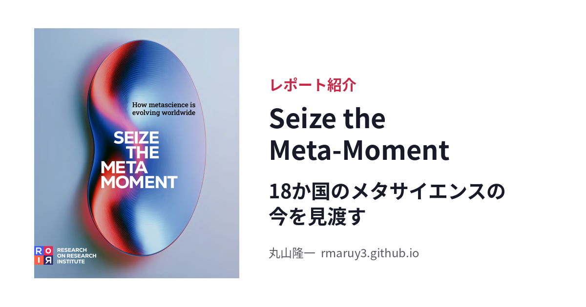
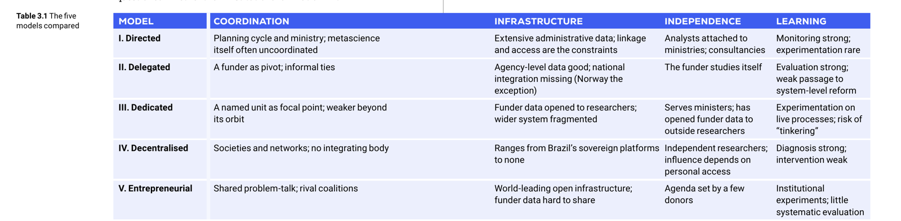
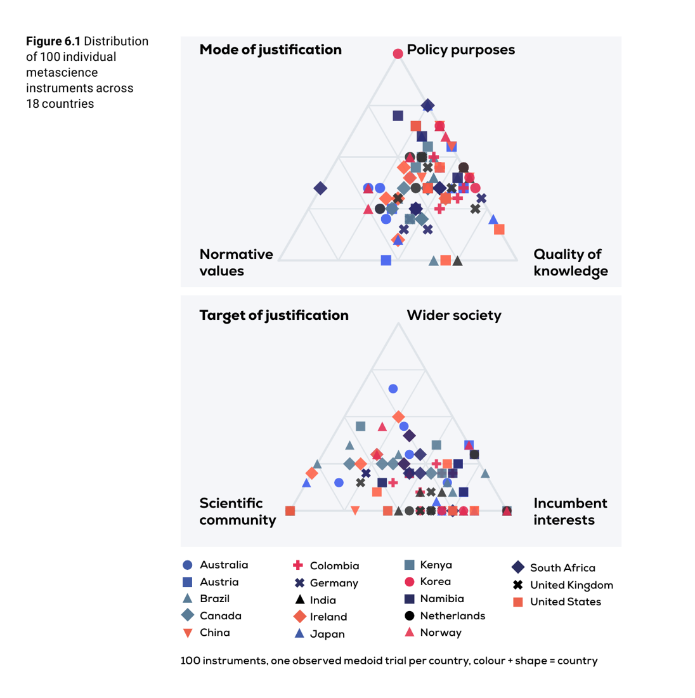
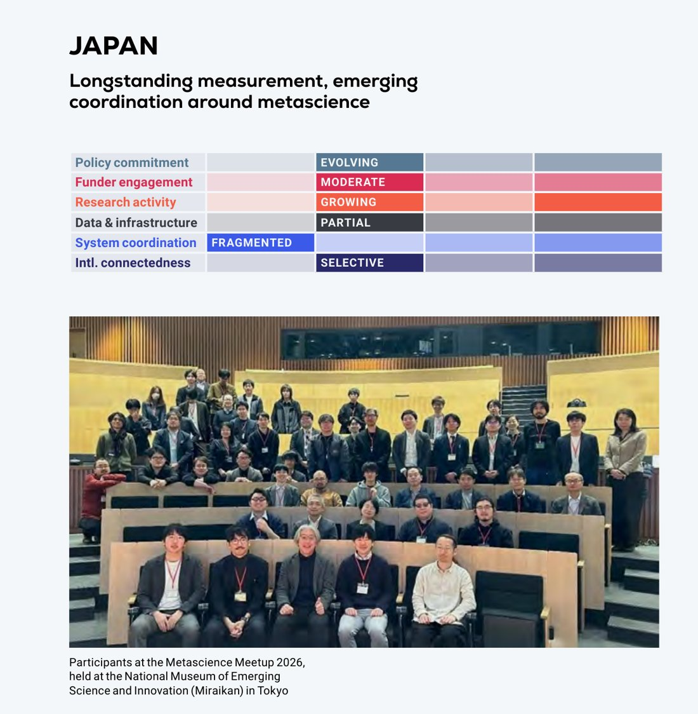

*表紙画像の出典：Wilsdon et al. (2026), CC BY 4.0*

本ブログでたびたび取り上げてきた「メタサイエンス運動」について、18か国の動向を調べた報告書が出ました。11月3日にバルセロナで公開された *Seize the meta-moment: how metascience is evolving worldwide*（Wilsdon et al., 2026）です。本体は250ページを超えます。[特設サイト](https://meta-moment.researchonresearch.org/)には、各国の詳しい事例研究や計量書誌分析も載っています。

とりまとめたのは、RoRI（Research on Research Institute）。RoRIは2019年に、英国のウェルカム・トラスト、シェフィールド大学、オランダのライデン大学、研究情報企業のDigital Scienceが共同で立ち上げた国際コンソーシアムです。研究資金配分機関（ファンダー）や大学などが加わり、研究費の配り方や研究の評価をデータとエビデンスに基づいて見直す「研究についての研究（research on research）」を進めてきました。RoRIを率いるJames Wilsdonさんは、この報告書の筆頭著者として全体のとりまとめを担っています。日本からも、菊地乃依瑠さんと林和弘さんが製作メンバーに加わり、日本の事例研究を担当されました。

## メタサイエンスとは何か

メタサイエンスとは何でしょうか。私はこれまで、メタサイエンスを「『営みとしての科学』を理解し、よりよく変えていく研究・実践」と説明してきました（JST-CRDSコラム[「メタサイエンスとは何か」](https://www.jst.go.jp/crds/column/kaisetsu/column75.html)、スライド[「メタサイエンス運動とは何か」](https://speakerdeck.com/rmaruy/20250520-metasaiensuyun-dong-tohahe-ka)）。科学は、人間の集団が資金や評価の仕組み、論文や査読といった制度に支えられて営むものです。そうである以上、その「やり方」自体を研究の対象にし、必要なら変えていこう、という考え方です。本報告書の定義は次のとおりです。

> In this report, we use metascience as an umbrella term for research and practice that examines how research is funded, organised, conducted, communicated, evaluated and used, and that seeks to improve these systems and practices.（p.14）
>
> （本報告書では、メタサイエンスを、研究がどのように資金配分され、組織され、実施され、伝達され、評価され、利用されるかを検証し、そうしたシステムや実践の改善を目指す研究と実践の総称として用いる。）

理解と改善の両方を含む点で、私の説明とほぼ重なります。

こうした関心を持つ人が分野を越えて集まる場として、2024年に有志で[メタサイエンス研究会](https://sites.google.com/view/metascience/home)が立ち上がり、私も運営に関わってきました。科学哲学者を中心に始まった会ですが、[勉強会](https://rmaruy3.github.io/blog/2024/08/29/post.html)を重ねるうちに、研究者、URA、行政官、企業の方へと輪が広がりました。今年3月には日本科学未来館で「メタサイエンス・ミートアップ2026」を開き、学術界、官庁、産業界から100人以上が集まりました（[参加メモ](https://rmaruy3.github.io/blog/2026/03/15/post.html)）。このミートアップには菊地さんの取り計らいで、Wilsdonさんからビデオメッセージもいただきました。そのタイトルはまさに「SEIZE THE META-MOMENT!」で、その様子はRoRIのサイトでも[紹介されています](https://researchonresearch.org/seizing-the-meta-moment-in-japan/)。

## 新しくはないが、いま注目されている

報告書でも繰り返し触れられているように、メタサイエンスは新しいものではありません。科学とは何か、良い科学とは何かを問う営みは、科学哲学や科学史、科学技術社会論（STS）が長く担ってきました。論文を数えて科学の動向をつかむ計量書誌学にも、数十年の蓄積があります。日本でも、科学技術・学術政策研究所（NISTEP）が1990年代から科学技術指標を出し続けていますし、私の前職のJST-CRDSも、研究開発の動向を俯瞰して政策に提言する仕事を続けてきました。[Metascience 2025の簡易報告](https://rmaruy3.github.io/blog/2025/07/19/post.html)にも書いたとおり、これまで日本にメタサイエンスがなかったわけではありません。名前がついていなかっただけです。報告書の1章も、こうした系譜を1918年のポーランドの学術誌やバナールの『科学の社会的機能』（1939年）までさかのぼって描いています。

では、今日のメタサイエンスに新しさがあるとしたら何か。私が見るかぎり、「メタサイエンス」という旗印のもとで、ばらばらに営まれてきたこれらの伝統と、研究者自身による改革運動、ファンダーや政府の実践が出会い始めたことです。そしてこの数年、その動きは各国の政策に入り込んできました。

英国は2024年に政府内に専門のメタサイエンス・ユニットを置き、研究費の配り方そのものを実験で検証し始めました。米国では国立科学財団（NSF）がメタサイエンス室を開き、アイルランドも専門部署の設置を約束しました。日本では第7期科学技術・イノベーション基本計画にメタサイエンスが書き込まれ、文部科学省のAI for Science事業「SPReAD 1000」は、審査の一部にランダムな選考を取り入れました。2027年には、文部科学省がメタサイエンスの視点から研究のプロセス改革を進める新事業「CATALYST」を始める予定です。

2026年10月に京都で開かれたSTSフォーラムでは、17か国が支持した閣僚声明「Kyoto Vision」に、メタサイエンスという言葉が登場しています。ただし、ボトムアップに始まったメタサイエンス運動が、このように政策主導になりすぎることへの懸念にも、このレポートは触れています。

タイトルの「Seize the meta-moment」は、「この機を逃すな（seize the moment）」のもじりです。いまメタサイエンスに集まる注目とモーメンタムをどう生かすかが、報告書を貫くテーマになっています。

## 各章の内容

### 1章　深い根、たくさんの枝（Deep Roots, Many Branches）

- メタサイエンスの歴史と系譜をたどる章。
- 各国の能力が育った経路は4つある。研究の再現性・研究公正の改革、ファンダーによる評価と制度設計、計量書誌学と指標、政府による研究システムの舵取り（governance and strategic learning）である。
- 2012年頃からは、新しい研究組織を立ち上げる制度起業家（institutional entrepreneurs）、自らのプロセスを実験するファンダー、AIといった新しい担い手が加わった。
- メタサイエンスは単一の分野ではなく「関連する伝統の家族（a family of related traditions）」として捉えるのがよい、と結論づける。

### 2章　メタサイエンスを地図にする（Mapping Metascience）

- 論文データベースでメタサイエンスの広がりを描く。各国が推薦した論文から関連文献を広げると、約48万件、131トピックに及ぶ。
- メタサイエンスは学問分野というより「関わり方（orientation）」であり、多くの研究者にとっては本業のかたわらの「副業（side hustle）」であり続けてよい、とする。

### 3章　国のメタサイエンス・システム（National Systems of Metascience）

- メタサイエンスを、国の研究システムが自らをモニターし、振り返り、適応する「自己省察の能力（reflexive capacity）」の一部として捉え直す。
- メタサイエンスの能力の組織のされ方で、18か国を5つのモデルに分ける。
- 国家主導型（Directed：日本、中国、韓国など）、ファンダーに任せる委任型（Delegated：オーストリア、カナダなど）、専門機関型（Dedicated：英国）、分散型（Decentralised：ドイツ、オランダなど）、起業家型（Entrepreneurial：米国）である。
- これは成熟度の序列ではなく、構成の違い（configuration rather than maturity）だと強調。
- ただし、政府がメタサイエンスの成果にどれだけ関心を持ち、吸収できるかには差が生じている。

*5つのモデルの比較（Table 3.1）。出典：Wilsdon et al. (2026), CC BY 4.0*

### 4章　メタサイエンス外交（Metascience Diplomacy）

- 科学外交（science diplomacy）の延長として、研究システムそのものが国際的なやりとりの対象になる状況を描く。
- 国際ネットワークは語彙や手法を運び、国内の改革者に正統性を与える。
- 最後に、国際的なつながりが本当に役立っているかを確かめる3つの問いを示す。一方通行ではなく、お互いに学び合えているか（互恵性、reciprocity）。特定の国や組織が抜けても続けられるか（レジリエンス、resilience）。海外で得たものが、国内の仕組みや人材として根づいているか（転換、conversion）。報告書は、3つ目が最も弱いとみている。

### 5章　研究システムのように見る（Seeing Like a Research System）

- タイトルは、政治学者James C. Scottの『国家のように見る（Seeing Like a State）』のもじり。研究情報のインフラは、何かを見えるようにすると同時に、別の何かを見えなくする。
- OpenAlexなどのオープンなデータベースは広がったが、「オープンは無料ではない」。
- 各国に共通する課題はデータの不足ではない。データ同士の連結、外部の研究者のアクセス、分析人材が足りないことである。

### 6章　メタサイエンスの政治性（The Politics of Metascience）

- メタサイエンスが避けがたく政治的であることを正面から論じる。
- この活動が生き残れるかどうかは、それが「誰に、どうやって正当化されるか」で決まる（正当化フレームワーク、Justification Framework）。正当化の相手は科学者、政府・産業、広い社会の3つで、最も手薄なのは広い社会への正当化である。
- 分野の行く末を3つのシナリオで描く。実践が当たり前になって名前が消える制度化（institutionalisation）、悪意がなくても無関心だけで分野が散る周縁化（marginalisation）、道具は残るが目的が統制に変わる取り込み（capture）である。どれになるかを決めるのは、エビデンスの質より政治的な関係だという。
- 結論は、政治性は学習の制約であると同時に、学習の条件でもある（politics as a condition of learning）というもの。エビデンスがどう使われたかが見え、それに異議を唱えられるところでのみ、研究システムは学ぶ。

*18か国の100の施策を、正当化の仕方（上）と正当化の相手（下）で配置した図（Figure 6.1）。下の図で、頂点の「広い社会（Wider society）」に向かう施策が少ないことが分かる。出典：Wilsdon et al. (2026), CC BY 4.0*

### 7章　この機を生かす（Making the Moment Count）

- 最後に、コミュニティが何をすべきかを提言。
- 共創（co-creation）が重要。研究者・政策担当者・実務家が問題の設定から一緒に取り組み、都合の悪い結果が出ても関係を続ける。
- 規模に見合った実験と評価を制度改革に組み込むことを求める。そのうえで、エビデンスはそれ自体では正統性（legitimacy）を生まないとして、指標の前提を公開し、評価される側が異議を唱えられる経路を用意することを提案する。
- この注目が去った後も残る関係性や習慣をこそ育むべきだと締めくくる。

## 日本はどう描かれているか

日本のメタサイエンスは、本レポートでは「国家主導型」に分類され、NISTEPの指標やJST-CRDSの調査に代表される、国家のための「戦略的インテリジェンス（strategic intelligence）」の伝統が強みとされています。一方で、助成の記録と論文がつながっていないこと、政策の因果的な評価が弱いこと、官僚の異動で制度設計の理由が失われること、研究評価の改革が5年ごとの計画のたびに「再発見」されてきたことが指摘されています。そうしたなかで、SPReAD 1000のランダム選考は、国家主導型の弱点とされる「実験の少なさ」から意図して抜け出す試みとして紹介されています。

巻末の国別ページでは、日本は「長年の測定と、メタサイエンスをめぐる新たな連携（Longstanding measurement, emerging coordination around metascience）」と題され、主要な担い手の一つとしてメタサイエンス研究会も挙げられています。添えられた写真は、3月のミートアップの集合写真です。

*日本の国別ページ。上は日本チームによる自己評価、下はメタサイエンス・ミートアップ2026の集合写真。出典：Wilsdon et al. (2026), CC BY 4.0*

## 感想

メタサイエンス研究会では11月16日に、この報告書を読んだメンバーで感想会を開きました。そこでは、内容には既視感のある議論も少なくない、という意見もありました。エビデンスを作ること自体を目的にしない、データを集めても使って変われなければ意味がない、といった議論は、科学技術イノベーション政策のEBPMやオープンサイエンス運動がたどってきたものの繰り返しでもあります。

筆者個人の感想としては、まず、ここまでまとめ上げたことが一つのマイルストーンだと感じました。18か国の事例を集めたことで、ひとまず世界中で何が起きているか、そして起きていないかを、不完全でも概観できるのは大きいことだと思います。そして、感想会で指摘された議論の反復についても、私はむしろ、その反復に一挙に片を付けようという執筆陣の意気込みをこの報告書に感じました。政治性を正面から扱っていることもその表れだと思います。

日本にとっては、海の向こうの動きとして後から輸入するのではなく、18か国の調査活動に日本が加われたことが大きいと思います。これからCATALYST事業が始まり、今月末には文部科学省主催のメタサイエンス・シンポジウムもあります。そこで大事なのは、各分野の専門家を意味のある形で巻き込み、共通言語を作れるかどうかだと思います。

また、本報告書で口を酸っぱくして書かれていたように、メタサイエンスが誰かの利害に奉仕するものになったとたんに、メタサイエンス運動の意義は減じてしまう。そうしたことに注意しつつ、日本においても「Seize the meta-moment」できるかどうか。これからの半年が正念場かもしれません。

## 参考

- Wilsdon, J. et al. (2026). *Seize the meta-moment: how metascience is evolving worldwide.* Research on Research Institute. DOI: [10.6084/m9.figshare.33455029](https://doi.org/10.6084/m9.figshare.33455029)（CC BY 4.0）
- 特設サイト：<https://meta-moment.researchonresearch.org/>
